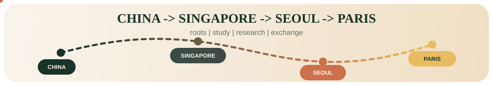

  

  
  
  
  

  

 

### ❖ Tech Stack

| | |
| :--- | :--- |
| **Programming Languages** |       |
| **Agentic Platforms** |     |
| **AI / ML Frameworks** |          |
| **Web & Backend** |        |
| **Data & Vector Stores** |      |
| **Developer Tools** |              |

 
 

  
  
  
  

EN • 中文 • FR 

